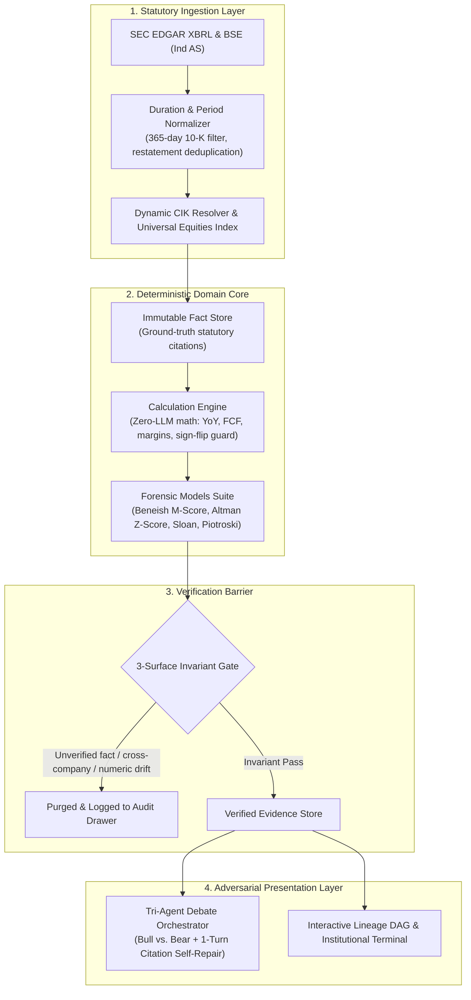

# Finvestigate — Evidence-First Financial Intelligence

[](LICENSE)
[](package.json)
[](tests/)

Finvestigate is a deterministic financial investigation engine and adversarial multi-agent debate platform for SEC EDGAR and BSE statutory filings.

Rather than delegating financial interpretation directly to Large Language Models (LLMs)—which are susceptible to numerical hallucinations, sign-flip errors, and fabricated citations—Finvestigate enforces a strict **Evidence Chain Hierarchy**:

$$\text{Statutory Source Fact} \longrightarrow \text{Deterministic Math Core} \longrightarrow \text{Forensic & Accounting Models} \longrightarrow \text{Adversarial Multi-Agent Debate}$$

---

## System Architecture



### Core Subsystems

#### 1. Statutory Ingestion Engine
- **XBRL Duration & Period Filtering**: Normalizes SEC EDGAR `companyfacts` feeds by isolating annual (`10-K`, `fp: "FY"`) duration tags ($\Delta t \in [350, 380]$ days) and resolving restatements via the latest `filed` timestamp.
- **Dynamic CIK Resolver**: Real-time ticker-to-CIK mapping (`company_tickers.json`) supporting arbitrary US public equities with zero-padded 10-digit identifiers.
- **Dual Regulatory Pipelines**: Ingests US SEC EDGAR filings alongside Indian statutory accounting standards (BSE / Ind AS).
- **Universal Equities Typeahead**: High-speed prefix indexing across SEC and BSE company directories via `/api/search`.

#### 2. Deterministic Calculation Core
- **Zero-LLM Arithmetic**: Financial metrics (YoY growth, gross margin, operating margin, Free Cash Flow $OCF - \text{CapEx}$) are evaluated exclusively by pure TypeScript functions with runtime Zod schema validation.
- **Sign-Flip Guard**: Formula bounds check identifying sign reversals across zero (e.g. swinging from $-\$2.7\text{B}$ to $+\$30.4\text{B}$) to prevent invalid division artifacts and emit domain signals (`sign_flip: true`).

#### 3. Adversarial Debate Engine
- **Constrained Tri-Agent Architecture**: A Bull Agent and Bear Agent construct evidence-grounded investment arguments constrained to verified calculation IDs, moderated by an impartial Judge Agent.
- **1-Turn Automated Citation Self-Correction**: If an agent generates an invalid reference or mismatched metric, the engine reflects the verification error back to the model for single-turn repair before falling back.
- **Deterministic Atomic Fallback**: If LLM services are unconfigured, rate-limited, or produce ungrounded claims, the engine atomically replaces the output with pre-verified deterministic findings (`mode: "deterministic_fallback"`).

#### 4. Verification Barrier & Mutation Guard
- **3-Surface Invariant Gate**: Intercepts and validates all generated Findings, Claim Checks, and Debate arguments before presentation. Statements citing ungrounded facts, cross-company references, or invalid URLs are purged.
- **Segregated Audit Telemetry**: Real-time rejection logging separating production filing audits from adversarial attack simulations.
- **Adversarial Attack Injector**: Production-hardened testing endpoint validating citation resistance against fabricated IDs, cross-company contamination, and numerical drift. Protected by `API_SECRET_KEY` in production environments.

---

## Forensic & Accounting Models

Finvestigate implements deterministic, quantitative forensic accounting models directly in code:

| Model | Classification & Methodology | Interpretation & Decision Boundary |
|---|---|---|
| **Beneish M-Score** | 8-variable probabilistic model: $\text{DSRI}, \text{GMI}, \text{AQI}, \text{SGI}, \text{DEPI}, \text{SGAI}, \text{LVGI}, \text{TATA}$ | $M > -1.78$: High probability of earnings manipulation<br>$M \le -1.78$: Low manipulation risk |
| **Altman Z-Score** | Multi-factor linear discriminant analysis evaluating working capital, retained earnings, EBIT, market equity, and asset turnover | $Z > 2.99$: Safe Zone<br>$1.81 \le Z \le 2.99$: Grey Zone<br>$Z < 1.81$: Financial Distress |
| **Sloan Accrual Ratio** | Accrual anomaly assessment: $\frac{\text{Net Income} - \text{Operating Cash Flow}}{\text{Total Assets}}$ | $> +10\%$: Aggressive accruals / low cash realization<br>$< -10\%$: High cash realization / conservative accounting |
| **Piotroski F-Score** | 9-point fundamental scorecard across profitability, leverage/liquidity, and operating efficiency | $8\text{--}9$: Strong financial position<br>$5\text{--}7$: Moderate position<br>$0\text{--}4$: Weak / high fundamental risk |
| **Cash Flow Divergence** | Invariant check comparing Operating Cash Flow growth vs. Net Income growth | Delta $> 10\%$ triggers earnings quality warning |
| **Receivables Divergence** | Invariant check comparing Accounts Receivable growth vs. Revenue growth | Delta $> 10\%$ triggers aggressive revenue recognition warning |

---

## Terminal Interface

Finvestigate features an institutional tabbed terminal interface:

- **Executive Overview**: High-level financial synopsis, key ratio trends, filing source verification, and fundamental trust scoreboards.
- **Forensic Radar**: Real-time evaluation of Beneish M-Score, Altman Z-Score, Sloan Accruals, Piotroski F-Score, and accounting divergence flags.
- **Courtroom Debate**: Adversarial Bull vs. Bear debate stream with highlighted citation lineage and Judge risk assessment.
- **Evidence Lineage DAG**: Interactive visual dependency graph linking raw SEC source facts to derived calculations and claims.
- **Compliance & Attack Center**: Audit drawer exposing verification rejection logs and real-time adversarial attack simulations.
- **Stateful Deep-Linking**: Full URL synchronization via `/company/:ticker/:tab`.
- **Dossier Export**: Dedicated print stylesheet formatted for physical audit dossiers and vector PDF exports.

---

## Technology Stack

| Layer | Technology | Purpose |
|---|---|---|
| **Frontend** | React 19, Vite, Vanilla CSS | Institutional terminal interface, glassmorphism UI, zero-runtime CSS overhead, print styles |
| **Backend API** | Node.js, Express 5, TypeScript | Domain routing, SSE streaming, static SPA delivery, rate limiting |
| **Security & Logging** | Helmet, Pino, Pino-HTTP | HTTP security headers, structured JSON logging with correlation IDs (`x-request-id`) |
| **Containerization** | Docker (`node:22-alpine`) | Multi-stage production container with unprivileged `node` user and container healthcheck |
| **Database** | SQLite (`better-sqlite3`) & Turso Cloud (`@libsql/client`) | Dual-adapter repository: zero-dependency local SQLite with automatic cloud failover |
| **Data Engine** | Zod, SEC EDGAR XBRL API, BSE / Ind AS | Runtime schema validation and primary statutory data sources |
| **Forensic Models** | Beneish, Altman, Sloan, Piotroski | Deterministic mathematical scoring of financial distress and manipulation risk |
| **LLM Orchestration** | Google Gen AI SDK (`@google/genai`) | Multi-agent debate synthesis with 1-turn citation repair and deterministic fallback |
| **Testing** | Vitest 3, Tsx | Forensic invariant, integration, security, and production E2E suites |

---

## API Reference

The backend exposes a REST API on port `3001` (configurable via `PORT`):

| Endpoint | Method | Auth | Description |
|---|---|---|---|
| `/health` | `GET` | Public | Service health check returning `{ status: "ok", service: "finvestigate-api", version: "1.0.0" }` |
| `/api/health` | `GET` | Public | API health check route alias |
| `/api/search` | `GET` | Public | Universal autocomplete search across US and Indian equities (`?q=<query>`) |
| `/api/investigations/:ticker` | `GET` | Public | Full investigation payload (facts, calculations, anomalies, forensic models, debate) |
| `/api/investigations/:ticker/stream` | `GET` | Public | Server-Sent Events (SSE) live progress and token streaming endpoint |
| `/api/verification-stats` | `GET` | Public | Verification audit statistics and rejection telemetry (`?ticker=<TICKER>`) |
| `/api/investigations/:ticker/attack` | `POST` | `API_SECRET_KEY` (prod) | Injects adversarial attack scenario (`fabricated_id`, `cross_company`, `numeric_hallucination`, `sign_flip_mismatch`) |

> [!NOTE]
> In production (`NODE_ENV=production`), mutating endpoints (`POST /api/investigations/:ticker/attack`) require authorization via `X-API-Key: <key>` or `Authorization: Bearer <key>`. If `API_SECRET_KEY` is not configured, mutations fail closed with HTTP 503.

---

## Getting Started

### Prerequisites

- Node.js `v18.0.0` or higher
- npm `v9.0.0` or higher
- Docker (optional, for containerized deployments)

### Installation

```bash
# Clone the repository
git clone https://github.com/Dhanush-Annam/Finvestigate.git
cd Finvestigate

# Install dependencies
npm install
```

> [!NOTE]
> **Native Dependency Note (`better-sqlite3`):** `better-sqlite3` is compiled for offline local persistence. Prebuilt platform binaries are installed automatically by npm.

---

## Environment Configuration

Copy the example configuration file:

```bash
cp .env.example .env
```

Configure variables in `.env` as required:

| Variable | Description | Required | Default |
|---|---|---|---|
| `GEMINI_API_KEY` | Google AI Studio API key for Gemini multi-agent debate synthesis | No (degrades to deterministic fallback) | — |
| `LLM_MODEL` | Gemini model ID for debate synthesis | No | `gemini-3.5-flash-lite` |
| `SEC_USER_AGENT` | User-Agent header complying with SEC EDGAR fair access policy | No | `"Finvestigate Research contact@finvestigate.dev"` |
| `TURSO_DATABASE_URL` | Turso Cloud libSQL connection URL for hosted persistence | No (falls back to local SQLite) | — |
| `TURSO_AUTH_TOKEN` | Turso Cloud authentication token | Required if `TURSO_DATABASE_URL` is set | — |
| `API_SECRET_KEY` | Secret token authorizing mutating attack endpoints | Required for attacks in production (`NODE_ENV=production`) | — |
| `PORT` | HTTP server listening port | No | `3001` |
| `NODE_ENV` | Runtime environment (`development`, `production`, `test`) | No | `development` |
| `ALLOWED_ORIGINS` | Permitted CORS origins (comma-separated) | No | `http://localhost:5173,http://localhost:3000,http://127.0.0.1:5173,http://127.0.0.1:3000` |
| `LOG_LEVEL` | Logging verbosity (`debug`, `info`, `warn`, `silent`) | No | `info` (silent in test) |

> [!IMPORTANT]
> **Graceful LLM Degradation:** Finvestigate maintains **100% test pass rates and full operational functionality without a Gemini API key**. If `GEMINI_API_KEY` is omitted, invalid, or rate-limited, the system executes deterministic debate generation with complete citation ground-truth.

---

## Persistence Architecture

Finvestigate utilizes a repository pattern supporting dual database backends:

- **Local Development: SQLite (`better-sqlite3`)**: Zero-configuration, offline-capable persistence stored at `data/finvestigate.db`. Configured in WAL mode with composite foreign keys `(run_id, <id>)`. The SQLite database is generated at runtime and excluded from source control.
- **Production: Turso Cloud (`@libsql/client`)**: Activated when `TURSO_DATABASE_URL` and `TURSO_AUTH_TOKEN` are provided. Connects to hosted libSQL infrastructure with batched transactions. If Turso becomes unreachable or credentials fail, the repository automatically fails over to local SQLite.
- **Reproducibility Fixtures**: Ground-truth historical data, SEC ticker maps, and curated company baselines are maintained under `data/cache/`, `data/curated/`, and `data/raw/`.

---

## Running the Application

### Local Development (Dual Process)

Execute the backend API and frontend development server in separate terminals:

```bash
# Terminal 1: Express API backend (http://localhost:3001)
npm run dev:api

# Terminal 2: Vite React frontend (http://localhost:5173)
npm run dev:web
```

### Production Build (Single Process)

In production, the Express backend serves both the API endpoints and the compiled single-page application from `dist/`:

```bash
# 1. Build client SPA and compile backend TypeScript
npm run build
npm run build:api

# 2. Start unified production server
npm start
```

The server listens on `http://localhost:3001` (or `$PORT`) and routes:
- Single-page application assets at `/`
- Equities autocomplete at `/api/search`
- Investigation SSE streaming at `/api/investigations/:ticker/stream`
- REST API at `/api/*`
- Health check endpoints at `/health` and `/api/health`

### Containerized Deployment (Docker)

A production-ready multi-stage Docker build is provided:

```bash
# Build production Docker image
docker build -t finvestigate .

# Launch container
docker run -p 3001:3001 -e PORT=3001 finvestigate
```

The container runs as an unprivileged `node` user on `node:22-alpine`, includes an automated container healthcheck (`wget --spider http://localhost:3001/health`), and encapsulates both frontend SPA and backend API services.

---

## Available Scripts

| Command | Description | Verification Status |
|---|---|---|
| `npm run dev:api` | Starts Express backend in development mode with hot reload via `tsx` | Verified in manifest |
| `npm run dev:web` | Starts Vite React frontend development server | Verified in manifest |
| `npm run build` | Validates TypeScript and compiles frontend SPA into `dist/` | Verified (Exit Code 0) |
| `npm run build:api` | Compiles server TypeScript into `server-dist/` | Verified (Exit Code 0) |
| `npm start` | Builds API and launches production Node.js server | Verified in manifest |
| `npm test` | Executes complete Vitest test suite (122 tests across 17 test files) | Verified (122/122 passed, Exit Code 0) |
| `npm run test:watch` | Runs Vitest in interactive watch mode | Verified in manifest |
| `npm run test:e2e` | Runs production end-to-end verification against live server | Verified (11/11 passed, Exit Code 0) |
| `npm run benchmark:llm` | Executes LLM grounding and hallucination benchmark suite | Verified in manifest |
| `npm run typecheck` | Typechecks full codebase without emitting assets | Verified (Exit Code 0) |

---

## Testing & Invariant Verification

Finvestigate maintains an evidence-backed verification suite covering forensic invariants, citation validation, adversarial scenarios, and deployment readiness:

```bash
# Run complete test suite (122 tests across 17 test files)
npm test

# Run production end-to-end verification
npm run test:e2e
```

### Test Suite Organization

- **Forensic Invariant Tests (`tests/forensic/` — 5 files)**: Validates mathematical derivations, citation lineage, cross-company contamination guards, and SEC EDGAR consistency.
- **Integration Tests (`tests/integration/` — 6 files)**: Validates database repository adapters (SQLite & Turso), evidence store caching, live SEC EDGAR ingestion, LLM debate orchestration, and SSE streaming / search.
- **Security & Mutation Tests (`tests/security/` — 1 file)**: Validates adversarial attack injection, schema constraints, and mutation endpoint authentication policies.
- **Unit Tests (`tests/unit/` — 5 files)**: Validates anomaly rules, financial formulas, fundamental scoring, reference integrity, and deterministic forensic models (Beneish M-Score, Altman Z-Score, Sloan Accruals, Piotroski F-Score).
- **Production E2E Verification (`scripts/verify-prod-e2e.ts`)**: Spawns the compiled production server, validates dual health endpoints, static asset delivery, full ticker retrieval, segregated audit telemetry, and mutation authorization enforcement (11/11 assertions passed).

---

## Project Structure

```
Finvestigate/
├── src/
│   ├── client/                    # React 19 Single Page Application
│   │   ├── components/            # Terminal tab components (ExecutiveOverviewTab, ForensicRadarTab, DebatePanel, etc.)
│   │   ├── types/                 # Client UI view models & types
│   │   ├── main.tsx               # SPA root component & state orchestrator
│   │   └── styles.css             # Vanilla CSS design system & print styles
│   ├── server/                    # Express 5 REST API & services
│   │   ├── api/                   # Server entry, SPA routing, CORS, rate limiting & mutation auth
│   │   ├── application/           # Evidence store & pipeline orchestration services
│   │   ├── domain/                # Financial math, findings, forensic models & verification gates
│   │   ├── infrastructure/        # External integrations
│   │   │   ├── db/                # Relational DB repositories (SqliteAdapter, TursoAdapter, fallback)
│   │   │   ├── llm/               # Courtroom debate orchestrator with 1-turn self-repair & fallback
│   │   │   └── sources/           # SEC EDGAR XBRL & BSE/Ind AS statutory ingestion adapters
│   │   └── types/                 # Server domain & DB entity schemas
│   └── shared/                    # Universal cross-tier Zod schemas, constants & utilities
├── data/
│   ├── cache/                     # Cached SEC ticker maps and historical facts (reproducibility fixture)
│   ├── curated/                   # Curated benchmarks (NVDA, AAPL, MSFT, AMD, GOOGL, INTC, RELIANCE, etc.)
│   ├── finvestigate.db            # Local SQLite database (runtime-generated; git-ignored)
│   └── raw/                       # Cached raw SEC EDGAR XBRL facts (reproducibility fixture)
├── tests/                         # Vitest test suites (122 tests across 17 test files — 100% passing)
│   ├── forensic/                  # Forensic invariant & verification tests (5 files)
│   ├── integration/               # Database, evidence store, EDGAR & LLM streaming/search tests (6 files)
│   ├── security/                  # Adversarial attack API & mutation auth tests (1 file)
│   └── unit/                      # Anomaly rules, calculations, forensic models & scorer unit tests (5 files)
├── scripts/
│   ├── verify-prod-e2e.ts         # Production end-to-end verification test suite
│   ├── benchmark.ts               # LLM grounding & hallucination benchmarks
│   ├── check-reliance.ts          # BSE statutory verification utility
│   └── reconcile-sources.ts       # Source data reconciliation utility
├── Dockerfile                     # Multi-stage production container definition
├── .dockerignore                  # Docker build context exclusions
├── dist/                          # Compiled frontend production assets (git-ignored)
├── server-dist/                   # Compiled backend Node.js production code (git-ignored)
├── LICENSE                        # MIT License
└── README.md                      # System architecture & evaluation guide
```

---

## License

Distributed under the MIT License. See [LICENSE](LICENSE) for more information.
