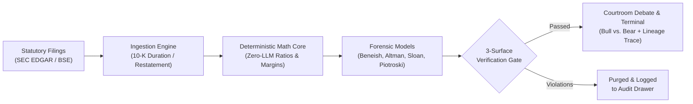

# Finvestigate

[](LICENSE)
[](package.json)
[](package.json)

Deterministic financial investigation engine and adversarial multi-agent debate platform for SEC EDGAR and BSE statutory filings.

> **Statutory Filings (SEC / BSE)** → **Deterministic Math Core** → **Forensic Accounting Models** → **Adversarial AI Debate**

---

## Architecture



Finvestigate eliminates Large Language Model (LLM) financial hallucinations by enforcing an evidence-grounded pipeline: LLMs never calculate numbers, cite ungrounded metrics, or summarize filings without deterministic verification.

### Core Pipelines

- **Dual Regulatory Ingestion**: Ingests annual SEC EDGAR XBRL filings (`companyfacts`, 10-K duration tags filtered to $\Delta t \in [350, 380]$ days with restatement deduplication) and Indian statutory accounting filings (BSE / Ind AS).
- **Zero-LLM Math Core**: Financial ratios (YoY growth, gross margin, operating margin, Free Cash Flow) are computed strictly via pure TypeScript domain functions with runtime Zod schema validation and sign-flip guards.
- **3-Surface Verification Barrier**: Intercepts ungrounded metrics, cross-company citation contamination, missing calculation references, and numeric drift before claims can reach presentations or debate outputs.
- **Constrained Tri-Agent Debate**: An adversarial Bull vs. Bear debate moderated by an impartial Judge agent, featuring 1-turn automated citation self-correction and atomic fallback to deterministic synthesis if verification fails.

---

## Forensic & Accounting Models

All financial calculations and anomaly detections are evaluated deterministically in pure TypeScript:

| Model | Methodology | Decision Boundary |
|---|---|---|
| **Beneish M-Score** | 8-variable probabilistic model (`DSRI`, `GMI`, `AQI`, `SGI`, `DEPI`, `SGAI`, `LVGI`, `TATA`) | **M > -1.78**: Manipulation risk flag<br>**M ≤ -1.78**: Normal reporting |
| **Altman Z-Score** | Multi-factor distress formula (working capital, retained earnings, EBIT, equity, sales) | **Z > 2.99**: Safe<br>**1.81 ≤ Z ≤ 2.99**: Grey Zone<br>**Z < 1.81**: Distress |
| **Sloan Accruals** | Accrual ratio: `(Net Income − Operating Cash Flow) / Total Assets` | **> +10%**: Aggressive accruals<br>**< -10%**: Conservative / cash-backed |
| **Piotroski F-Score** | 9-point fundamental scorecard across profitability, leverage, and efficiency | **8–9**: Strong<br>**5–7**: Moderate<br>**0–4**: Weak |
| **Accounting Invariants** | YoY divergence between Cash Flow vs. Net Income, and Receivables vs. Revenue | **> 10% delta** triggers audit flag |

---

## Institutional Terminal Interface

The frontend provides a tabbed financial terminal:

- **Executive Overview**: Key metrics, filing provenance, and fundamental health trust scoreboards.
- **Forensic Radar**: Real-time evaluation of Beneish, Altman, Sloan, and Piotroski scores.
- **Courtroom Debate**: Adversarial Bull vs. Bear debate stream with 1-turn citation self-repair and Judge verdict.
- **Evidence Lineage DAG**: Interactive visual dependency graph linking raw SEC filings to derived calculations and claims.
- **Compliance & Attack Center**: Audit drawer exposing verification rejection logs and live adversarial injection testing.
- **Deep-Linking & Print CSS**: Browser URL routing (`/company/:ticker/:tab`) and dedicated vector PDF export styling.

---

## API Reference

The backend exposes a REST API on port `3001` (configurable via `PORT`):

| Endpoint | Method | Auth | Description |
|---|---|---|---|
| `/health`, `/api/health` | `GET` | Public | Service health check returning `{ status: "ok", service: "finvestigate-api", version: "1.0.0" }` |
| `/api/search` | `GET` | Public | Universal equities autocomplete across US and Indian tickers (`?q=<query>`) |
| `/api/investigations/:ticker` | `GET` | Public | Full investigation payload (facts, ratios, forensic models, debate) |
| `/api/investigations/:ticker/stream` | `GET` | Public | Server-Sent Events (SSE) live investigation progress and token stream |
| `/api/verification-stats` | `GET` | Public | Verification audit statistics and rejection telemetry (supports optional `?ticker=<ticker>`) |
| `/api/investigations/:ticker/attack` | `POST` | `API_SECRET_KEY` | Injects adversarial scenario to test verification resistance (`fabricated_id`, `cross_company`, `numeric_hallucination`, `sign_flip_mismatch`) |

> [!NOTE]
> Mutation endpoints require `API_SECRET_KEY` passed via `X-API-Key` or `Authorization: Bearer <key>` in production. In development mode, calls are permitted with a default policy header when `API_SECRET_KEY` is unset.

---

## Getting Started

### Prerequisites

- Node.js `v18.0.0` or higher (Node 20+ or 22 recommended)
- npm `v9.0.0` or higher
- Docker (optional, for containerized runtimes)

### Quickstart

```bash
# 1. Clone repository & install dependencies
git clone https://github.com/Dhanush-Annam/Finvestigate.git
cd Finvestigate
npm install

# 2. Configure environment
cp .env.example .env

# 3. Start development servers (Express API on :3001, Vite React on :5173)
npm run dev:api   # Terminal 1
npm run dev:web   # Terminal 2
```

> [!TIP]
> **Zero-Config Offline Mode:** Finvestigate operates out-of-the-box using local SQLite (`better-sqlite3`). If `GEMINI_API_KEY` is omitted, the engine automatically degrades to its deterministic debate generator with 100% test pass rates and zero external dependencies.

---

## Environment Configuration

Configure variables in `.env` as required:

| Variable | Description | Required | Default |
|---|---|---|---|
| `GEMINI_API_KEY` | Google AI Studio API key for multi-agent debate synthesis (also accepts `GOOGLE_GENAI_API_KEY`) | No (deterministic fallback) | — |
| `LLM_MODEL` | Gemini model ID for debate synthesis | No | `gemini-3.5-flash-lite` |
| `SEC_USER_AGENT` | User-Agent header complying with SEC EDGAR fair access policy | No | `"Finvestigate Research contact@finvestigate.dev"` |
| `TURSO_DATABASE_URL` | Turso Cloud libSQL connection URL for hosted persistence | No (falls back to local SQLite) | — |
| `TURSO_AUTH_TOKEN` | Turso Cloud authentication token | If remote Turso URL set | — |
| `TURSO_STRICT` | If `true`, throws on Turso connection error instead of falling back to SQLite | No | `false` |
| `API_SECRET_KEY` | Secret token authorizing mutating attack endpoints | Production only | — |
| `PORT` | HTTP server listening port | No | `3001` |
| `NODE_ENV` | Runtime environment (`development`, `production`, `test`) | No | `development` |
| `ALLOWED_ORIGINS` | Permitted CORS origins (comma-separated) | No | `http://localhost:5173, http://localhost:3000` |
| `LOG_LEVEL` | Logging verbosity (`debug`, `info`, `warn`, `silent`) | No | `info` (silent in test) |

---

## Production & Container Deployment

### Local Production Build

```bash
# 1. Build frontend SPA and compile backend TypeScript
npm run build:all

# 2. Launch unified production server on :3001
npm start
```

Alternatively, to build tiers individually:

```bash
npm run build       # Compiles client SPA to dist/
npm run build:api   # Compiles backend TypeScript to server-dist/
node server-dist/server/api/server.js
```

### Docker Multi-Stage Container

```bash
# Build and run production container
docker build -t finvestigate .
docker run -p 3001:3001 -e PORT=3001 finvestigate
```

### Vercel Serverless Deployment

Finvestigate includes native Vercel configuration (`vercel.json` and `api/index.ts`):

- **Build Command**: `npm run build`
- **Output Directory**: `dist`
- **Serverless API Function**: Routes `/api/*` and `/health` requests to the Express backend handler in `api/index.ts` (configured for Turso hosted persistence).

---

## Developer Scripts & Testing

| Command | Purpose |
|---|---|
| `npm run dev:api` | Starts backend in development mode with hot reload (`tsx`) |
| `npm run dev:web` | Starts Vite React frontend development server |
| `npm run build` | Compiles client SPA to `dist/` with typechecking |
| `npm run build:api` | Compiles server TypeScript to `server-dist/` |
| `npm run build:all` | Compiles both client SPA and server TypeScript |
| `npm run clean:api` | Removes the compiled `server-dist/` directory |
| `npm run typecheck` | Typechecks full codebase without emitting assets |
| `npm start` | Compiles server TypeScript and launches unified production server |
| `npm test` | Executes full Vitest suite (122 tests across 17 files — 100% pass) |
| `npm run test:watch` | Runs Vitest in interactive watch mode |
| `npm run test:e2e` | Runs production end-to-end verification against live server instance |
| `npm run benchmark:llm` | Runs LLM grounding and hallucination benchmark suite |

### Test Suite Architecture

The test suite covers 122 tests across 17 files with 100% pass rate:

- **Unit Tests (`tests/unit/` — 5 files)**: Validates anomaly rules, financial formulas, fundamental scoring, reference integrity, and deterministic forensic models (Beneish M-Score, Altman Z-Score, Sloan Accruals, Piotroski F-Score).
- **Forensic & Invariant Tests (`tests/forensic/` — 5 files)**: Enforces accounting invariants, source reconciliation, verification gate rules, and cross-company isolation.
- **Integration Tests (`tests/integration/` — 6 files)**: Validates database repository adapters (SQLite & Turso), evidence store caching, live SEC EDGAR ingestion, LLM debate orchestration, and SSE streaming / search.
- **Security Tests (`tests/security/` — 1 file)**: Validates adversarial attack injection, schema constraints, and mutation endpoint authentication policies.
- **Production E2E Verification (`scripts/verify-prod-e2e.ts`)**: Spawns compiled production server, validates dual health endpoints, static asset delivery, full ticker retrieval, segregated audit telemetry, and mutation authorization enforcement (11/11 assertions pass).

---

## Project Structure

```
Finvestigate/
├── src/
│   ├── client/                    # React 19 Single Page Application
│   │   ├── components/            # Terminal tab components (ExecutiveOverview, ForensicRadar, etc.)
│   │   ├── types/                 # Client UI view models & types
│   │   ├── main.tsx               # SPA root component & state orchestrator
│   │   └── styles.css             # Terminal design system & print styles
│   ├── server/                    # Express 5 REST API & backend services
│   │   ├── api/                   # Server entry, routing, CORS, rate limiting & mutation auth
│   │   ├── application/           # Evidence store & pipeline orchestration services
│   │   ├── domain/                # Financial math, forensic models & verification gates
│   │   └── infrastructure/        # DB repositories (SQLite/Turso), LLM debate, and SEC/BSE sources
│   └── shared/                    # Universal cross-tier Zod schemas, constants & types
├── data/
│   ├── cache/                     # Cached SEC ticker maps and historical facts
│   ├── curated/                   # Curated benchmarks (NVDA, AAPL, MSFT, AMD, GOOGL, INTC, RELIANCE)
│   ├── finvestigate.db            # Local SQLite database (runtime-generated; git-ignored)
│   └── raw/                       # Cached raw SEC EDGAR XBRL facts
├── tests/                         # Vitest test suites (122 tests across 17 test files)
│   ├── forensic/                  # Forensic invariant & verification tests
│   ├── integration/               # Database, evidence store, EDGAR & LLM streaming/search tests
│   ├── security/                  # Adversarial attack API & mutation auth tests
│   └── unit/                      # Anomaly rules, calculations, forensic models & scorer unit tests
├── scripts/                       # Production verification, benchmarking, and reconciliation utilities
├── Dockerfile                     # Multi-stage production container definition
├── LICENSE                        # MIT License
└── package.json                   # Project metadata, scripts, and dependencies
```

---

## License

Distributed under the MIT License. See [LICENSE](LICENSE) for more information.
